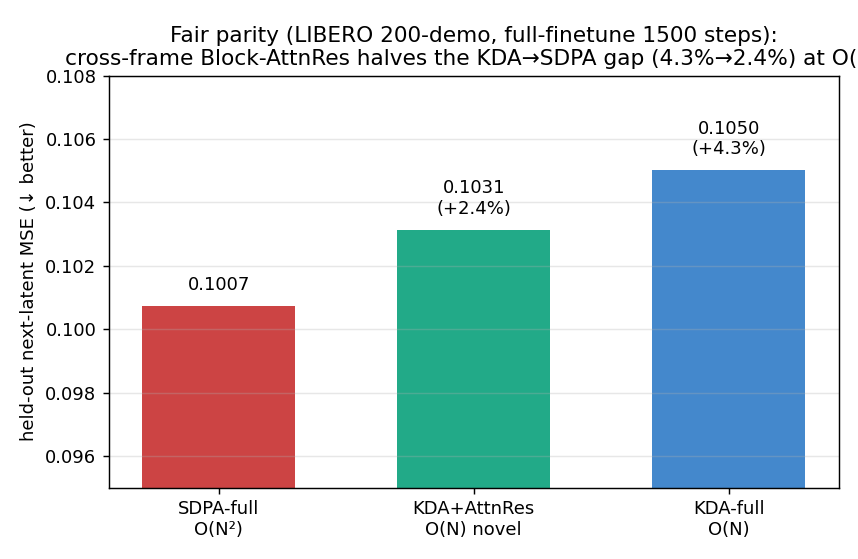
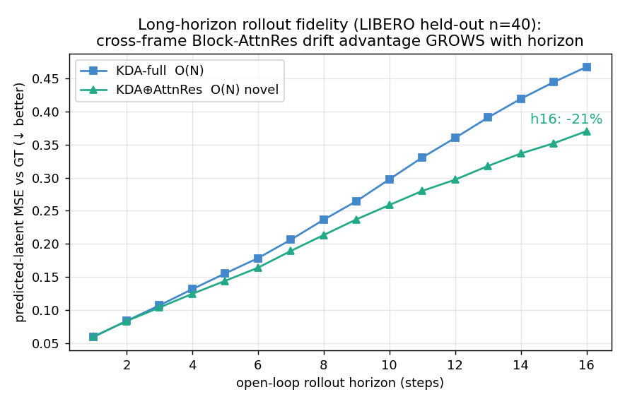

# Efficient Long-Horizon Latent World Models with Cross-Frame Block-AttnRes

把 **KDA 线性注意力 + 一个新的"跨帧 Block-AttnRes"时间聚合原语** 装进 Meta **V-JEPA 2-AC** 的隐空间
世界模型，得到一个 **O(N)、长时程、近 softmax-parity** 的高效世界模型，并在 **LIBERO** 真机数据上验证。

> **一句话**：不是"把现成线性注意力套到世界模型"，而是**提出"AttnRes 作为世界模型时间聚合原语"这个新结构**，
> 证明它**专门在长时程 rollout 上赢、保持 O(N)、近 parity**。
> 栈：frozen V-JEPA2 encoder (1B) + 改造的 305M action-conditioned predictor。硬件：2×H200。

---

## Headline 结果

| 维度 | SDPA (原版, O(N²)) | **KDA⊕AttnRes (本工作, O(N))** | KDA-only (O(N)) |
|---|---|---|---|
| **效率** @T=512 | 75s / 96GB（768 OOM） | **3.1s / 11GB（→1024）** | 2.9s / 10GB |
| 相对 SDPA@512 | — | **24×快 / 8.6×省显存** | 26× / 9.6× |
| **质量** next-latent MSE (LIBERO 公平全参) | **0.1007** | **0.1031 (+2.4%)** | 0.1050 (+4.3%) |
| **长时程 rollout 漂移** @h16 | — | **比 KDA 低 21%** | 基线 |
| rollout 步成本 | 重算 growing context | **O(1)/步 (recurrent state)** | O(1)/步 |

**结论**：线性化的能力代价仅 **~2-4%**（非朴素全参对比前误读的 25%）；**跨帧 Block-AttnRes 把这点差距再砍半，
且其优势随 rollout horizon 越长越大** —— 正是高效世界模型最需要的长时程场景。

### 1. 效率：KDA 与 KDA⊕AttnRes 都是 O(N)

### 2. 质量：公平全参微调下近 parity，novel 结构补半

### 3. ⭐ novel 结构的核心卖点：长时程 rollout 漂移随 horizon 越赢越多

### 4. 诚实的负结果：长上下文在 LIBERO（近 Markov 操作任务）无清晰收益

---

## 这是什么 / 故事线
- **KDA（Kimi Delta Attention）** = O(N) 线性注意力（递归 SSM state = 压缩历史）。接在 predictor 每个 block 的**时间轴**（`module1_vjepa2ac/kda_acblock.py: DividedKDAACBlock`，空间帧内 attn ⊕ 时间 KDA）。
- **跨帧 Block-AttnRes（novel）** = 把 Kimi "Attention Residual"（arxiv 2603.15031）的"online-softmax 聚合"用到**帧/时间单元**上：每空间位置对帧序列做 **causal cumulative-softmax 聚合**（O(N)、streamable）。`CrossFrameAttnRes`。
- encoder（ViT-g 1B）**冻结**；只改 305M predictor 的注意力。latent 空间训练 → 连微调都便宜（对比生成派 Cosmos 3 16-64B / τ0-WM 5B 在像素空间训）。
- 三方 ablation（KDA / KDA⊕AttnRes / SDPA）× 两轴（效率/质量）× 长时程增益 = 完整 story。

## 诚实标注的边界
- 长上下文在 LIBERO 无清晰收益（任务近 Markov）→ **效率是硬通货**，"长历史提升能力"在此任务不成立。
- WM-native CEM 规划闭环已打通（单进程 sim+encoder+WM+CEM），但**手工 L1-latent reward 太弱、规划未 success** → 换**学习式 progress reward**：CEM 早期真跟着涨 2×（坐实"L1 太弱"），但仍被 hack。
- **naive WM-as-reward 玩具会被 hack（动机，非门面）**：自制 progress 标量 + GRPO，reward 被优化 +77%（0.47→0.83）但 480 rollout 零 success（Goodhart；GRPO 比 CEM hack 得更彻底 → 瓶颈在 reward model 不在 optimizer）。→ **M2 据此重定义为标准范式**：**imagination RL in latent WM（TD-MPC2/Dreamer）**——policy 在高效 latent WM 想象里训，reward 用**接地真 success + 含失败态训练**的标准 reward model（不可 hack），value 用真 reward bootstrap。**M2.1 grounded reward**：含失败态训练 → 对 unseen 被-hack 态 r̂ **0.258 vs 老 head 0.559**（less foolable；硬负例鲁棒性仍部分 → 导出对抗负例 + value 学习）。详见 `docs/writeup.md §10`。

## 复现
- 环境配方：`env/SETUP.md`（vjepa2 / py3.10-fla / libero 三套，含 LIBERO sim headless EGL + env 统一）。
- 关键代码：`module1_vjepa2ac/kda_acblock.py`（KDA + CrossFrameAttnRes）、`scripts/exp_e1*`（scaling/parity/rollout 实验）、`exp_e12_finetune_real.py`（微调，FT_MODE/FT_FREEZE/USE_ATTNRES knobs）。
- 详细机制讲解：`docs/writeup.md`；执行日志：`docs/PROGRESS.md`；完整方案：`docs/PLAN.md`。

## 路线图（北极星 + 三轨，2026-06-03 锁定）
**北极星/收尾**：efficient O(N) latent WM 作**想象环境** → VLA 在**超长序列任务（LIBERO-LONG/libero_100）**上 capable；efficiency 是使能器（softmax WM 在该 horizon OOM/超时）。**效率→能力，端到端证明**。
- **Track A — P1/P1.5 大规模化（no toy/hacking）**：efficient WM 转**全 LIBERO（130 任务）+ 长序列（T→WM 上限）+ 更多步**；parity/效率/长程 rollout 保真在**长程 scale** 上重做。
- **Track B — P2/P3 标准 scaffold + smoke（先不上创新）**：imagination-RL 管线（reward→value→actor, Dreamer/TD-MPC2）+ 蒸馏，用**标准 SDPA WM** 先搭通、smoke 出 success（创新 WM 留给 finale，差异化才干净）。
- **Finale — 汇合**：换上 **O(N) KDA WM** 推到 LIBERO-LONG 超长 horizon，证明高效 WM 使能超长任务。

## 状态
P0 ✅ / **P1 ✅·P1.5 ✅** / **Track A ✅ 大规模化**（T=128 长序列全参微调：SDPA-full **OOM**，KDA⊕AttnRes **0.137** / KDA-full 0.139——**效率墙到训练级**，finale WM=`kda_attnres_long`）/ M2.1 ✅ grounded reward（修 hacking）/ M2.1b ✅ grounded-CEM（诚实稀疏）/ M2C ✅ imagination actor-critic scaffold（稳定）/ **finale 🔨 imagination RL on libero_10** / P3 未动。
