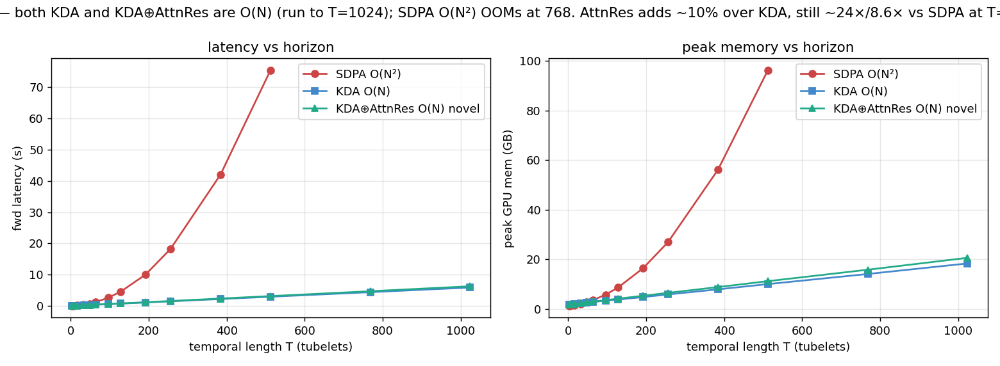
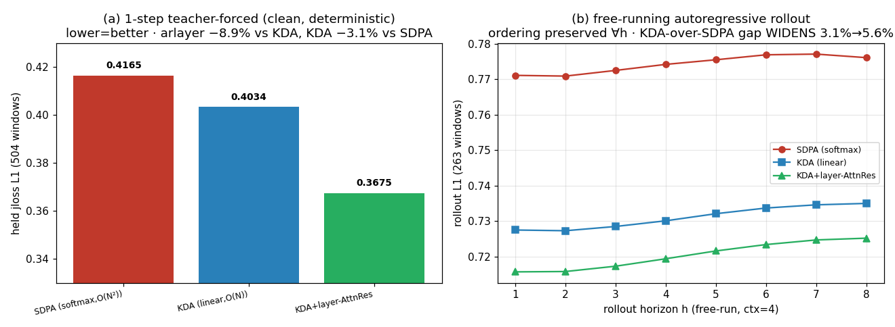
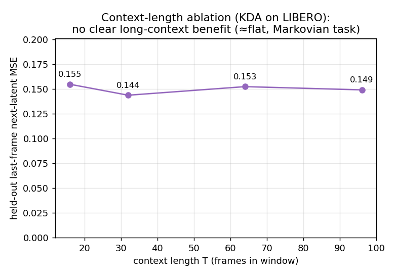

# Efficient O(N) Long-Horizon Latent World Models — Linear KDA + Cross-Layer Block-AttnRes

把 **KDA 线性注意力（时间轴）+ Kimi "Block-AttnRes"（深度/层残差轴）** 装进 Meta **V-JEPA 2-AC** 隐空间
世界模型，得到 **O(N)、长时程** 的高效 WM，并在 **LIBERO** 真机数据上以**官方 V-JEPA2-AC 标准 recipe**（L1 + jloss/sloss rollout + WSD）微调验证。

> **一句话**：把 softmax **O(N²)** 时间注意力换成 **O(N) KDA 线性注意力** —— 不但不亏质量，**在自回归 rollout（世界模型的真实用途）上对 softmax 的优势反而放大**；再叠一道**跨层 Block-AttnRes**（深度轴、~parameter-free）补单步表征增益。
> 栈：frozen V-JEPA2 encoder (1B) + 改造的 305M action-conditioned predictor。硬件：2×H200。
> ⚠️ **门面 pitch 修订中（2026-06-03）**：旧版卖的是"跨**帧** AttnRes 的 rollout 越赢越多"——该架构已废弃（与 KDA 跨帧冗余）。正确的**跨层** AttnRes 给出下面更诚实的故事，headline 框架待 owner 复核。

---

## Headline 结果（官方标准 recipe，matched 3000-iter，确定性 held-out）

**效率（自回归 rollout @T=512，KDA vs SDPA；跨层 AttnRes ~parameter-free 故效率≈KDA）：**
| 维度 | SDPA (O(N²)) | **KDA (O(N))** |
|---|---|---|
| 时间 / 显存 @T=512 | 75s / 96GB（768 OOM） | **2.9s / 10GB（→1024 不 OOM）** |
| 相对 | — | **~26×快 / ~9.6×省显存** |
| rollout 步成本 | 重算 growing context O(N²) | **O(1)/步（recurrent SSM state）** |

**质量（held-out L1，越低越好；最严格版：libero_10 全部 10 个长任务完全 held-out，train 仅 libero_90；exp_e15/e16, writeup §13d）：**
| 指标 | SDPA (softmax) | KDA (linear) | **KDA+layer-AttnRes** |
|---|---|---|---|
| 1-步 teacher-force, clean held (3197 窗口) | 0.41644 | 0.41343 | **0.37033** |
| free-run 自回归 rollout, mean L1 (1708 窗口) | 0.7738 | 0.7393 | **0.7229** |

**结论（诚实，nuanced；全-10-held × 两指标 × 全 8 horizon 排序一致、可复现）：**
1. **跨层 Block-AttnRes 单步表征增益 −10.4%**（vs KDA）—— 在 10 个完全 unseen 长任务上**鲁棒泛化**（比 2-held 的 −8.9% 还略大）；free-run rollout 下缩到 −2.2%（仍正）。AttnRes 主要提升**单步表征质量**。
2. **KDA(linear, O(N)) match SDPA(softmax)**：1-步近 parity（−0.7%），但**优势在 free-run rollout 上放大到 −4.5%** —— 线性 WM 正是**更好的自回归想象引擎**（也是 imagination-RL 环境）。"linear 亏质量"在标准 recipe 下**不成立**。
3. 方法论：训练内部**随机 noisy held** 曾误报 arlayer>kda；**确定性 3197-窗口 eval 推翻之** → 坚持确定性大样本 eval（详见 `docs/writeup.md §13c/§13d`，2-held 与 10-held 结论一致）。

### 1. 效率：KDA 是 O(N)，softmax O(N²)

### 2. ⭐ 质量 + rollout 保真：KDA 对 softmax 的优势随 horizon 放大，AttnRes 补单步增益

### 3. 诚实的负结果：长上下文在 LIBERO（近 Markov 操作任务）无清晰收益

---

## 这是什么 / 故事线
- **KDA（Kimi Delta Attention）** = O(N) 线性注意力（递归 SSM state = 压缩历史）。接在 predictor 每个 block 的**时间轴**（`module1_vjepa2ac/kda_acblock.py: DividedKDAACBlock`，空间帧内 attn ⊕ 时间 KDA）。
- **跨层 Block-AttnRes（Kimi arxiv 2603.15031，深度轴）** = 在 24 个 predictor block 的**层残差/深度轴**上做注意力残差：把 L 层分成 8 组，组边界用 zero-init pseudo-query 对**所有已完成组的输出**做 softmax 加权，重组"下一组输入"（~parameter-free，9K 参数）。**与 KDA 正交**（KDA=时间轴，AttnRes=深度轴）。`block_attn_res` / `attnres_ify_predictor`。
  - ⚠️ 早期误把 AttnRes 当"跨帧时间聚合"——与 KDA 跨帧冗余、反而掉点，已废弃；正确实现是上面的**跨层**。
- encoder（ViT-g 1B）**冻结**；只改 305M predictor 的注意力。latent 空间训练 → 连微调都便宜（对比生成派 Cosmos 3 16-64B / τ0-WM 5B 在像素空间训）。
- 三方 ablation（KDA / KDA⊕AttnRes / SDPA）× 两轴（效率/质量）× 长时程增益 = 完整 story。

## 诚实标注的边界
- 长上下文在 LIBERO 无清晰收益（任务近 Markov）→ **效率是硬通货**，"长历史提升能力"在此任务不成立。
- WM-native CEM 规划闭环已打通（单进程 sim+encoder+WM+CEM），但**手工 L1-latent reward 太弱、规划未 success** → 换**学习式 progress reward**：CEM 早期真跟着涨 2×（坐实"L1 太弱"），但仍被 hack。
- **naive WM-as-reward 玩具会被 hack（动机，非门面）**：自制 progress 标量 + GRPO，reward 被优化 +77%（0.47→0.83）但 480 rollout 零 success（Goodhart；GRPO 比 CEM hack 得更彻底 → 瓶颈在 reward model 不在 optimizer）。→ **M2 据此重定义为标准范式**：**imagination RL in latent WM（TD-MPC2/Dreamer）**——policy 在高效 latent WM 想象里训，reward 用**接地真 success + 含失败态训练**的标准 reward model（不可 hack），value 用真 reward bootstrap。**M2.1 grounded reward**：含失败态训练 → 对 unseen 被-hack 态 r̂ **0.258 vs 老 head 0.559**（less foolable；硬负例鲁棒性仍部分 → 导出对抗负例 + value 学习）。详见 `docs/writeup.md §10`。

## 复现
- 环境配方：`env/SETUP.md`（vjepa2 / py3.10-fla / libero 三套，含 LIBERO sim headless EGL + env 统一）。
- 关键代码：`module1_vjepa2ac/kda_acblock.py`（`kda_ify_predictor` + `attnres_ify_predictor` 跨层）、`scripts/exp_e14_sft_full.py`（官方标准 recipe 全参 SFT，FT_MODE/USE_ATTNRES/AR_NUM_BLOCKS knobs）、`exp_e15`（1-步确定性 held）、`exp_e16`（多步 rollout-fidelity）。
- 详细机制讲解：`docs/writeup.md`；执行日志：`docs/PROGRESS.md`；完整方案：`docs/PLAN.md`。

## 路线图（北极星 + 三轨，2026-06-03 锁定）
**北极星/收尾**：efficient O(N) latent WM 作**想象环境** → VLA 在**超长序列任务（LIBERO-LONG/libero_100）**上 capable；efficiency 是使能器（softmax WM 在该 horizon OOM/超时）。**效率→能力，端到端证明**。
- **Track A — P1/P1.5 大规模化（no toy/hacking）**：efficient WM 转**全 LIBERO（130 任务）+ 长序列（T→WM 上限）+ 更多步**；parity/效率/长程 rollout 保真在**长程 scale** 上重做。
- **Track B — P2/P3 标准 scaffold + smoke（先不上创新）**：imagination-RL 管线（reward→value→actor, Dreamer/TD-MPC2）+ 蒸馏，用**标准 SDPA WM** 先搭通、smoke 出 success（创新 WM 留给 finale，差异化才干净）。
- **Finale — 汇合**：换上 **O(N) KDA WM** 推到 LIBERO-LONG 超长 horizon，证明高效 WM 使能超长任务。

## 状态
P0 ✅ / **P1 ✅·P1.5 ✅** / **架构定论 ✅·严格泛化复核 ✅**（官方标准 recipe matched 3000-iter 全参 SFT；最严格：libero_10 **全 10 长任务完全 held-out**：**跨层 AttnRes 0.370 < KDA 0.413 < SDPA 0.416** @1-步 clean held(3197窗口)；free-run rollout 同序，AttnRes −10.4%/KDA-over-SDPA rollout −4.5%；finale WM=`kda_arlayerH10`，2-held 与 10-held 一致、可复现 §13d）/ M2.1 ✅ grounded reward（修 hacking）/ M2.1b ✅ grounded-CEM（诚实稀疏）/ M2C ✅ imagination actor-critic（稳定，验证 WM 端到端接入）/ **finale ✅ 端到端打通**（真 sim eval）/ P3 未动 / **task#12 真 VLA × Ultra-Long 🔄 进行中**（战场换到非饱和的 LiLo-VLA Ultra-Long；OFT env 建好、baseline 0%；想象成本/RL 墙双证；蒸馏+想象RL 在建）。

## Finale 诚实结论
- **效率论点（项目真贡献）成立**：自回归 rollout @T=512 下 softmax 75s/96GB（768 OOM），O(N) KDA 2.9s/10GB（→1024）；T=128 全参训练 SDPA 需 act-ckpt（慢）、KDA 原生训得动 → 高效 WM **能**当 softmax 烧不起的长程想象环境。
- **全管线端到端打通**：grounded reward（修 hacking）→ imagination actor-critic（稳定）→ BC warm-start → 真 sim eval。
- **能力（真 sim success）**：单阶段 libero_spatial **8.3%**（管线可行）；多阶段 **LIBERO-LONG 0%**——根因是 **policy class 太弱**（微型 reactive MLP + mean-pool latent、无语言/记忆），**非 WM 或训练法**。**不伪称"解决了 LIBERO-LONG"**。详见 `docs/writeup.md §12`。

## task#12 — 效率使能超长程想象 RL（真 VLA × Ultra-Long，进行中）
libero_10 已饱和（OFT 94.5% / SimpleVLA-RL 98.5%）→ 换到**非饱和**战场 **LiLo-VLA Ultra-Long**（9/16-步组合任务，baseline 0% / SOTA 44%，有真 headroom）。
- 🎯 **想象成本双证（核心命题）**：① 单步 WM forward：SDPA **OOM@T=768、68s@512**；KDA **5.3s@512（13×）、撑到 768**（`imagination_cost.png`）。② 可微想象 RL：SDPA **OOM@H=48（133GB）连一步训不了**；KDA/AttnRes **14.7/17.6GB 跑完**（`m2j_imagine_rl_3way.png`）。→ **softmax WM 烧不起超长想象 RL，O(N) KDA WM 是使能器**。
- **OFT baseline on Ultra-Long = 0%**（真 VLA，libero_10 上 94.5% → Ultra-Long 0%，仅 ~0.3/5 子目标），坐实 headroom（与 LiLo-VLA 论文一致）。
- **接口 nuance**：V-JEPA2 无像素 decoder → 像素 VLA 不能直接进 latent 想象；走 **A2：OFT 蒸成 latent 策略 + 想象 RL**（文献空白:JEPA-latent 想象 RL for VLA，§related_work）。蒸馏 + 想象-RL 抬 success **在建**（诚实:SOTA 44%，提升不确定）。
详见 `docs/task12_plan.md` + `docs/related_work.md`。
